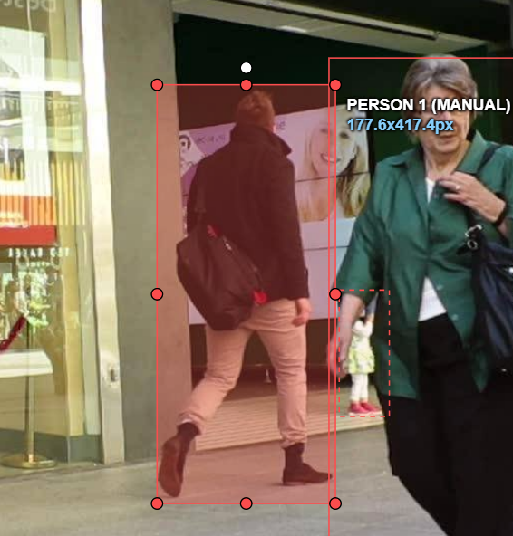
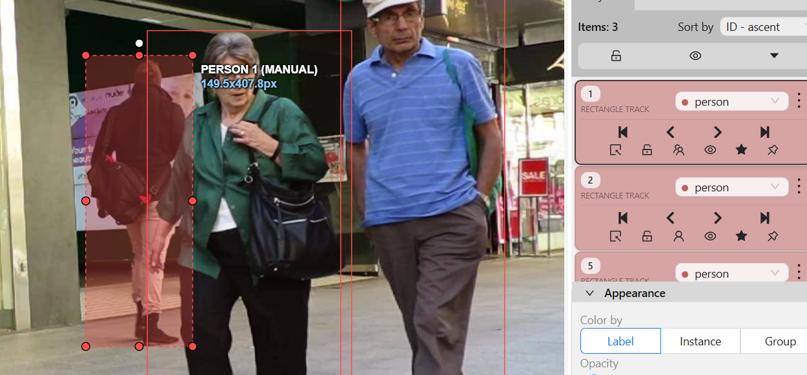
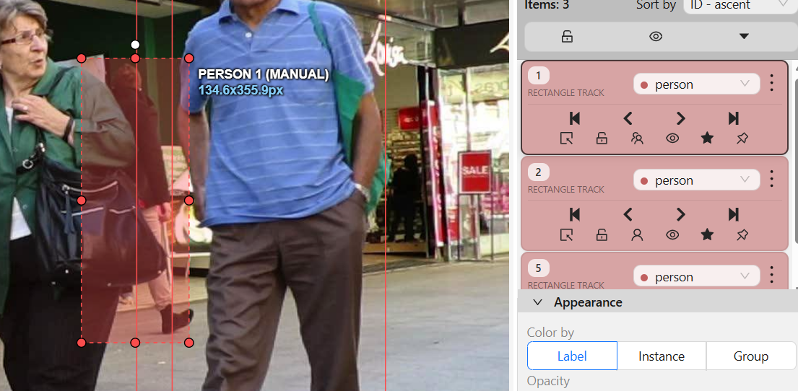

# Báo cáo cá nhân — NguyenTienDat-2A202603289

Đoạn video: MOT17-09, 150 frame (frame 1–150), nguồn MOTChallenge, giấy phép CC BY-NC-SA 3.0.

## 0. Thông tin học viên

- Họ tên: Nguyễn Tiến Đạt
- MSSV: 2A202603289
- Mã đề (A/B/C): C
- Email: nguyentiendat.qc2004@gmail.com
- Link repository: https://github.com/datpro-sudo/K5-L2B-NguyenTienDat-2A202603289-Day05-MOTTracking
- Giờ bắt đầu: 16h00
- Giờ kết thúc: 19h30

## 1. Xem trước đoạn video (CP0)

| Mã | Frame xuất hiện | Frame cuối thấy được | Rẽ / dừng / đổi tốc độ ở frame | Bị che ở frame | Ghi chú |
|---|---:|---:|---:|---:|---|
| P1 | 01 | 137 | 45 | 111 | Có đoạn outside tại CVAT frame 120–123 |
| P2 | 01 | 150 | Chưa ghi nhận | Chưa ghi nhận | Theo dõi hết đoạn video |
| P3 | 01 | 106 | 25 | 91 | Có đoạn bị che khuất |
| P4 | 01 | 111 | 27 | 107 | Có đoạn bị che khuất |
| P5 | 01 | 150 | Chưa ghi nhận | Chưa ghi nhận | Theo dõi hết đoạn video |

## 2. Keyframe và thời gian (CP1, CP4)

Số liệu keyframe lấy từ kết quả `src/check_submission.py`. Danh sách frame keyframe dưới đây sử dụng cách đánh số CVAT, bắt đầu từ 0.

| Mã | Track ID | Số keyframe | Keyframe ở frame | Số frame có mặt | Keyframe / 100 frame | Thời gian (phút) | Chỗ khó |
|---|---:|---:|---|---:|---:|---|---|
| P1 | 0 | 58 | Xem danh sách bên dưới | 133 | 43.6 | Chưa tách riêng | Đoạn bị che khuất và outside |
| P2 | 1 | 135 | Xem danh sách bên dưới | 150 | 90.0 | Chưa tách riêng | Nhiều lần chỉnh box, mật độ keyframe cao |
| P3 | 2 | 30 | Xem danh sách bên dưới | 106 | 28.3 | Chưa tách riêng | Đoạn bị che khuất |
| P4 | 3 | 31 | Xem danh sách bên dưới | 111 | 27.9 | Chưa tách riêng | Đoạn bị che khuất |
| P5 | 4 | 129 | Xem danh sách bên dưới | 150 | 86.0 | Chưa tách riêng | Nhiều lần chỉnh box, mật độ keyframe cao |
| **Tổng** | **5 track** | **383** | — | **650** | **58.9** | **210 phút tổng thời gian thực hiện** | **P2 và P5 có keyframe dày** |

### Danh sách keyframe theo từng track

- **P1 – Track 0 (58 keyframe):**  
  `0, 6, 7, 8, 9, 10, 12, 13, 14, 15, 16, 17, 18, 19, 20, 21, 22, 23, 24, 25, 26, 27, 28, 29, 30, 31, 32, 33, 34, 35, 36, 37, 38, 39, 40, 41, 42, 43, 44, 45, 46, 47, 48, 49, 50, 51, 110, 112, 113, 114, 115, 116, 117, 118, 119, 124, 125, 129`

- **P2 – Track 1 (135 keyframe):**  
  `0, 9, 10, 11, 12, 13, 14, 15, 16, 17, 18, 19, 20, 21, 22, 24, 25, 26, 27, 28, 30, 31, 32, 34, 36, 37, 40, 41, 42, 43, 44, 45, 46, 47, 48, 49, 50, 51, 52, 53, 54, 55, 56, 57, 58, 59, 60, 61, 62, 64, 65, 66, 67, 68, 69, 70, 71, 72, 73, 74, 75, 76, 77, 78, 79, 80, 81, 82, 83, 84, 85, 86, 87, 88, 89, 90, 91, 92, 93, 94, 95, 96, 97, 98, 99, 100, 101, 102, 103, 104, 105, 106, 107, 108, 109, 110, 111, 112, 113, 114, 115, 116, 117, 118, 119, 120, 121, 122, 123, 124, 125, 126, 127, 128, 129, 130, 131, 132, 133, 134, 135, 136, 137, 138, 139, 140, 141, 142, 143, 144, 145, 146, 147, 148, 149`

- **P3 – Track 2 (30 keyframe):**  
  `0, 8, 9, 10, 11, 12, 14, 15, 17, 18, 20, 21, 24, 26, 27, 28, 31, 32, 33, 34, 38, 41, 46, 47, 49, 51, 52, 60, 90, 98`

- **P4 – Track 3 (31 keyframe):**  
  `0, 8, 10, 11, 13, 14, 16, 17, 18, 19, 21, 22, 23, 24, 25, 26, 28, 31, 32, 33, 34, 36, 37, 38, 39, 41, 42, 43, 44, 45, 105`

- **P5 – Track 4 (129 keyframe):**  
  `0, 8, 10, 11, 12, 13, 14, 15, 16, 17, 18, 19, 20, 21, 22, 23, 24, 25, 26, 27, 28, 29, 30, 31, 32, 33, 34, 35, 36, 37, 38, 39, 40, 41, 42, 43, 44, 45, 46, 47, 48, 49, 50, 51, 53, 54, 56, 57, 59, 61, 62, 63, 64, 65, 66, 67, 68, 69, 70, 72, 73, 74, 76, 78, 79, 80, 81, 82, 83, 84, 85, 87, 88, 89, 90, 91, 92, 93, 94, 95, 96, 97, 101, 102, 103, 104, 105, 106, 107, 108, 109, 111, 112, 113, 114, 115, 116, 117, 119, 120, 121, 122, 123, 124, 125, 126, 127, 128, 129, 130, 131, 132, 133, 134, 135, 136, 137, 138, 139, 140, 141, 142, 143, 144, 145, 146, 147, 148, 149`

### Tính toán và nhận xét

Keyframe / 100 frame của cả bài:

`383 / 650 × 100 = 58.9 keyframe / 100 frame`.

Theo kết quả checker, P2 có 135 keyframe trên 150 frame, tương đương 90.0 keyframe/100 frame; P5 có 129 keyframe trên 150 frame, tương đương 86.0 keyframe/100 frame. Tôi đã mở CVAT kiểm tra lại và xác nhận hai cảnh báo keyframe dày ở P2 và P5 là đúng.

Nguyên nhân là trong quá trình gán nhãn, khi chỉnh sửa vị trí hoặc kích thước bounding box tại một frame, CVAT tự tạo keyframe để lưu thay đổi. Việc chỉnh box ở nhiều frame liên tiếp làm số keyframe tăng cao. P1, P3 và P4 không bị checker cảnh báo về mật độ keyframe.

Nếu thực hiện lại, tôi sẽ ưu tiên đặt keyframe tại các thời điểm người đổi hướng, thay đổi tốc độ, thay đổi kích thước bounding box, bị che khuất hoặc xuất hiện trở lại. Ở đoạn chuyển động ổn định, tôi sẽ kiểm tra chất lượng nội suy trước khi chỉnh box để tránh tạo keyframe không cần thiết.

## 3. Đoạn bị che (CP2)

Người được chọn để ghi nhận đoạn outside: **P1**.

Các frame trong bảng này ghi theo chỉ số frame CVAT, bắt đầu từ 0.

| Mốc | Frame CVAT |
|---|---:|
| Bắt đầu bị che một phần (bật `occluded`) | Cần đối chiếu ảnh/video |
| Mất hẳn (bật `outside`) | 120 |
| Hiện lại (tắt `outside`) | 124 |
| Thấy rõ trở lại (tắt `occluded`) | Cần đối chiếu ảnh/video |

- Thời gian khuất hẳn theo đoạn outside được checker ghi nhận: **4 frame (120–123)**.
- Quyết định: **Giữ cùng ID P1** khi xác định người xuất hiện lại là cùng một người.
- Lý do: Đoạn outside chỉ kéo dài 4 frame, ngắn hơn ngưỡng 60 frame của guideline. Khi người xuất hiện lại, cần đối chiếu ngoại hình, vị trí, hướng và tốc độ di chuyển để xác nhận đúng người trước khi tiếp tục dùng ID cũ.

**Ảnh chụp màn hình CP2:** :







## 4. Tự review ID (CP3)

Trong quá trình tự kiểm tra, tôi phát hiện bounding box bị lệch khỏi người ở một số frame nội suy khi người thay đổi tư thế. Tôi đã chỉnh sửa lại bounding box tại các frame bị lệch để box bám sát người hơn.

| Frame | Mã người | Loại lỗi | Mô tả một câu | Phát hiện ở lượt | Đã sửa? |
|---|---|---|---|---|---|
| Một số frame nội suy, chưa ghi lại số frame cụ thể | P1–P5, cần đối chiếu track thực tế | `drift` | Bounding box nội suy bị lệch khỏi cơ thể khi người thay đổi tư thế; tôi đã chỉnh lại box tại các frame bị ảnh hưởng. | CP3 – tự review | Có |

### Tổng hợp số lỗi theo loại

| `id_switch` | `fragmentation` | `lost` | `merge` | `false_track` | `drift` | `flag` |
|---:|---:|---:|---:|---:|---:|---:|
| Chưa ghi nhận | Chưa ghi nhận | Chưa ghi nhận | Chưa ghi nhận | Chưa ghi nhận | 1 dạng lỗi đã phát hiện và sửa | Chưa ghi nhận |

Lỗi bounding box bị lệch là lỗi `drift`. Lỗi xuất hiện khi vị trí hoặc tư thế người thay đổi nhưng box nội suy không còn bao sát cơ thể. Tôi đã phát hiện và sửa bằng cách điều chỉnh bounding box tại những frame bị ảnh hưởng.

Khi review theo cảnh, việc quan sát đồng thời nhiều người giúp phát hiện các box bị lệch hoặc chồng lấn mà khi chỉ tập trung theo dõi riêng từng người có thể khó nhận ra. Tôi đã kiểm tra và chỉnh các trường hợp box nội suy bị lệch được phát hiện. Các loại lỗi ID khác cần được ghi nhận riêng nếu phát hiện trong quá trình review.

## 5. File xuất và kết quả tự kiểm (CP4)

| Kiểm tra | Kết quả |
|---|---|
| Tên file MOT 1.1 | `NguyenTienDat_mot.zip` |
| Tên file CVAT for video 1.1 | `NguyenTienDat_cvat_video.zip` |
| Số track ID khác nhau trong `gt/gt.txt` | 5 – Đạt |
| Tổng số bounding box trong MOT 1.1 | 650 |
| Frame `outside` không có dòng trong `gt.txt` | Đúng theo thống kê checker |
| Job đã completed trên CVAT máy cá nhân | Cần xác nhận trạng thái Job |

### Kết quả tự kiểm MOT 1.1

- Số track ID: 5.
- Tổng số box: 650.
- Track ID 1: 133 frame có mặt, từ CVAT frame 0–136; đoạn outside 120–123.
- Track ID 2: 150 frame có mặt, từ frame 0–149.
- Track ID 3: 106 frame có mặt, từ frame 0–105.
- Track ID 4: 111 frame có mặt, từ frame 0–110.
- Track ID 5: 150 frame có mặt, từ frame 0–149.
- Checker xác nhận đúng 5 track ID.

### Kết quả tự kiểm CVAT for video 1.1

- Đọc được 5 track từ `annotations.xml`.
- Tổng số keyframe: 383.
- Tổng số frame có mặt: 650.
- Mật độ trung bình: 58.9 keyframe/100 frame.
- Có 2 cảnh báo keyframe dày:
  - Track 1 (P2): 90.0 keyframe/100 frame.
  - Track 4 (P5): 86.0 keyframe/100 frame.
- Không có lỗi định dạng.

### Tóm tắt kết quả checker

```text
=== File MOT 1.1: NguyenTienDat_mot.zip ===
Số track ID: 5 | Tổng số box: 650
[OK] Đúng 5 track ID.

Track | Frame có mặt | Số frame | Đoạn vắng (outside)
1     | 0–136        | 133      | 120–123
2     | 0–149        | 150      | -
3     | 0–105        | 106      | -
4     | 0–110        | 111      | -
5     | 0–149        | 150      | -

=== File CVAT for video 1.1 ===

Track | Nhãn   | Frame thấy | Keyframe | KF/100 frame
0     | person | 133       | 58       | 43.6
1     | person | 150       | 135      | 90.0
2     | person | 106       | 30       | 28.3
3     | person | 111       | 31       | 27.9
4     | person | 150       | 129      | 86.0

Tổng: 383 keyframe / 650 frame có mặt
     = 58.9 keyframe / 100 frame

[OK] Đọc được 5 track từ annotations.xml.

=== Tóm tắt ===
Lỗi: 0 | Cảnh báo: 2
Không có lỗi định dạng.
```

### Nhận xét kết quả CP4

Hai file export được script đọc thành công. File MOT 1.1 có đúng 5 track ID và 650 bounding box. File CVAT for video 1.1 có đủ 5 track trong `annotations.xml`. Script không phát hiện lỗi định dạng.

Hai cảnh báo keyframe dày ở P2 và P5 đã được kiểm tra trực tiếp trên CVAT và được xác nhận là đúng. Đây là cảnh báo về mật độ keyframe, không phải lỗi định dạng file. Tôi đã ghi nhận hạn chế này trong báo cáo.

## 6. Ba câu kết

**1. Nếu được gán lại, bạn sẽ đặt keyframe khác ở đâu? Vì sao?**

Nếu được thực hiện lại, tôi sẽ giảm việc chỉnh box ở các frame liên tiếp khi chuyển động của người ổn định. Tôi sẽ tập trung đặt keyframe tại các thời điểm người đổi hướng, thay đổi tốc độ, thay đổi tư thế, kích thước bounding box hoặc bị che khuất. Đặc biệt, tôi sẽ kiểm tra kỹ các frame nội suy khi người thay đổi tư thế để bổ sung keyframe đúng vị trí, tránh box bị lệch.

**2. Có chỗ nào bạn không chắc "cùng ID hay ID mới"? Bạn đã quyết định và ghi chú thế nào?**

Khi người bị che khuất rồi xuất hiện lại, tôi đối chiếu thời gian khuất, ngoại hình, vị trí xuất hiện lại và hướng/tốc độ di chuyển. Với đoạn P1 bị outside từ frame 120 đến 123, thời gian vắng là 4 frame, ngắn hơn ngưỡng 60 frame. Khi xác định người xuất hiện lại là cùng người, tôi tiếp tục sử dụng ID cũ thay vì tạo track mới.

**3. Một lỗi ID trong job của bạn có thể làm xe tự lái dự đoán sai chuyển động của người đó như thế nào? Lỗi đó ảnh hưởng MOTA hay IDF1 nhiều hơn?**

Nếu một người bị gán nhầm ID, hệ thống theo dõi có thể hiểu nhầm một người thành hai người khác nhau hoặc ghép chuyển động của hai người thành một. Điều này khiến xe tự lái dự đoán sai quỹ đạo và hướng di chuyển của người đi bộ, từ đó đánh giá sai nguy cơ va chạm. Lỗi đổi ID thường ảnh hưởng rõ hơn đến IDF1 vì IDF1 đánh giá khả năng duy trì danh tính đối tượng qua nhiều frame. MOTA cũng có thể bị ảnh hưởng thông qua thành phần ID switch.

## Bonus (nếu làm)

### B1 — Hai người đi sát


### B2 — So cách đặt keyframe

| Cách đặt | Số keyframe | Frame trôi nhất | Ghi chú |
|---|---:|---|---|
| Đều mỗi 30 frame |  |  |  |
| Theo chỗ đổi hướng |  |  |  |

### B3 — So với tracker có sẵn

Chưa thực hiện / chưa có số liệu ghi nhận.

## 7. Tài liệu tham khảo và công cụ AI đã dùng

1. MOTChallenge – MOT17 dataset, nguồn video sử dụng trong bài thực hành.
2. CVAT – Computer Vision Annotation Tool, công cụ gán nhãn và theo dõi đối tượng.
3. `docs/GUIDELINE.md` – Hướng dẫn gán nhãn, keyframe, occlusion và quản lý ID của bài lab.
4. `docs/CVAT_CHEATSHEET.md` – Bảng phím tắt và thao tác CVAT.
5. `src/check_submission.py` – Script tự kiểm tra file MOT 1.1 và CVAT for video 1.1.
6. ChatGPT – Hỗ trợ giải thích thao tác CVAT, keyframe, outside, occluded và hỗ trợ trình bày báo cáo dựa trên số liệu tự kiểm do học viên cung cấp.
